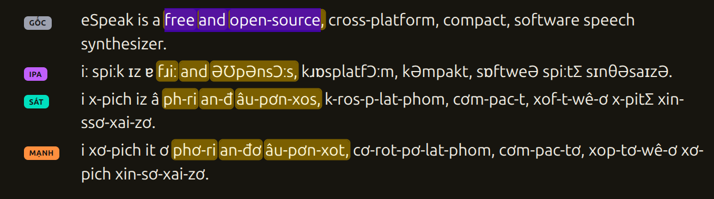

<div align="center">

# 🇻🇳 Vietify-web

**Give foreign pronunciation a Vietnamese-style spelling.**

[](https://vietify-spelling.github.io/vietify-web/)
[](https://vietify-spelling.github.io/vietify-web/)
[](LICENSE)

</div>

---

## 🌐 Web app — no install needed

> **👉 [Open the web app](https://vietify-spelling.github.io/vietify-web/)**
>
> Type or paste text (or drop a `.txt` file), pick a language, and get the Vietnamese-style spelling. Works on phone and desktop. Nothing is uploaded: everything runs locally in your browser.

Supports **English (UK/US), French, German, Russian, Mandarin (pinyin), Japanese (Hepburn)** and raw **IPA** input. The interface is in **Tiếng Việt** or **English**.

---

## 💡 Why this exists

Vietnamese learners of a foreign language often struggle with unfamiliar sounds. Vietify doesn't translate meaning — it shows how a word *sounds*, spelled the way a Vietnamese speaker would read it:

```text
Bonjour tout le monde   ──▶   bông-ʒuʁ tul-môngd
```

Under the hood, [eSpeak NG](https://github.com/espeak-ng/espeak-ng) (compiled to WebAssembly) turns text into IPA, then a rule table maps IPA to Vietnamese spelling.

This is the browser version of the Python tool Vietify (itself based on [ipa-to-vie](https://github.com/vuadu/ipa-to-vie)), with the same output.

---

## 🚀 Usage


### 1. Enter your text

Type or paste text, or drop / browse a UTF-8 `.txt` file. Mandarin takes **pinyin** (`ni3 hao3`), Japanese takes **Hepburn romaji** (`konnichiwa`), not hanzi or kana.

### 2. Pick a language and mode

| Mode | What it does |
| --- | --- |
| 😊 **Default** | Shows all three results below. |
| 🤓 **Weak** (*Sát*) | Keeps foreign sounds as they are. |
| 🤪 **Strong** (*Việt hóa mạnh*) | Replaces sounds Vietnamese lacks with close Vietnamese ones. |
| 💯 **IPA** | The IPA pronunciation only. |

A loaded **file** is converted line by line (IPA, strong and weak for every line) and can be downloaded as a `.txt`.

### 3. Convert, listen, compare

- **Convert** (or <kbd>Ctrl</kbd>+<kbd>Enter</kbd>) shows the result. 🔊 **Speak** reads the input aloud.
- **So sánh từng câu** (*Compare sentence by sentence*) opens a full-screen view, one block per sentence:

```text
 GỐC    Bonjour tout le monde.
 IPA    bɔ̃ʒuʁ tulmɔ̃d.
 SÁT    bông-ʒuʁ tul-môngd.
 MẠNH   bông-giuc tu-mông-đơ.
```

  **Select words** in any line and the matching words light up in all four lines — even when eSpeak fuses several words into one. <kbd>Esc</kbd> or **Thoát** returns to the converter.

---

## 🧭 How it works

```text
          ┌────────────┐   ┌──────────────┐   ┌────────────────┐
 text ───▶│ eSpeak NG  │──▶│ normalise    │──▶│ parse + rules  │──▶ weak / strong
          │ (WASM, IPA)│   │ IPA quirks   │   │ per syllable   │
          └────────────┘   └──────────────┘   └────────────────┘
```

Everything is plain static files: no server, no build step, no framework. The Python pipeline was ported function by function, and a test suite replays **400+ results from the Python version** and requires identical output.

---

## 🗂 Project layout

| Path | Purpose |
| --- | --- |
| `public/` | The deployable site (HTML, CSS, JS, WASM). |
| `public/js/core/` | Parsers and converters ported from Python. |
| `public/js/phonemize.js`, `pipeline.js` | The `phonemizer` replacement and the text → Vietnamese pipeline. |
| `public/js/align.js`, `interleave.js` | Sentence splitting and word alignment for the comparison view. |
| `public/espeak/` | eSpeak NG 1.51 as WebAssembly, with English/French/German/Russian/Mandarin/Japanese data (≈ 2.4 MB gzipped). |
| `wasm/` | Build script and C glue for the WebAssembly engine. |
| `tools/` | Generate rule tables and the Python reference corpus. |
| `test/` | Parity and alignment tests. |
| `PORTING.md` | Design notes and known differences from the Python version. |

### Run locally

```sh
npm run serve        # http://localhost:8080  (needs http, not file://)
npm test             # Node ≥ 22, no dependencies
npm run build:wasm   # rebuild the eSpeak engine (emsdk, autotools, espeak-ng 1.51 data)
```

---

## 🤝 Contributing

Contributions, bug fixes and new ideas are welcome. Open an issue or a pull request.

---

## 📜 License

**GPL-3.0-or-later** (the app bundles eSpeak NG and ports Vietify, both GPL). Based on [ipa-to-vie](https://github.com/vuadu/ipa-to-vie) by Rezza Inc. (MIT). See [`public/NOTICE.txt`](public/NOTICE.txt).

---

<div align="center">

*Made for people who learn languages by ear — and by eye.* 🎧

</div>
